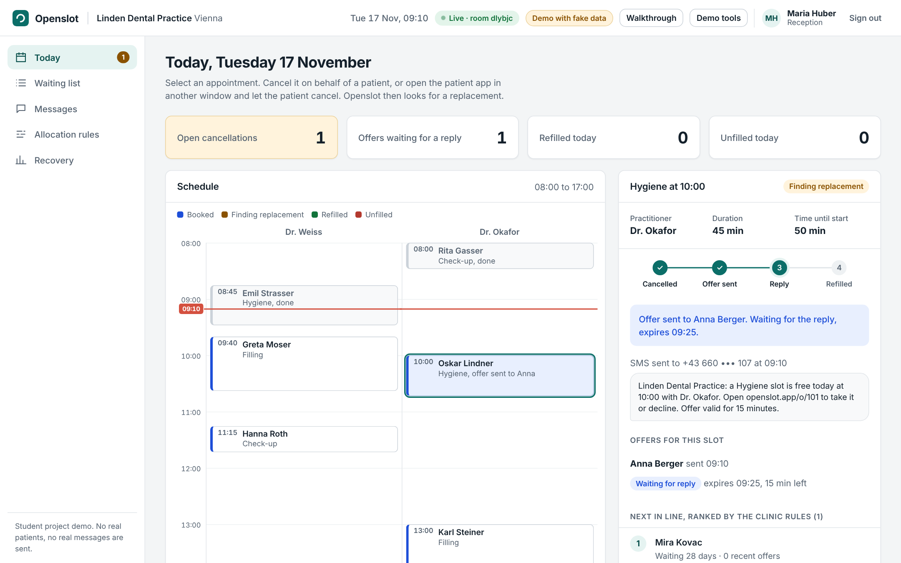
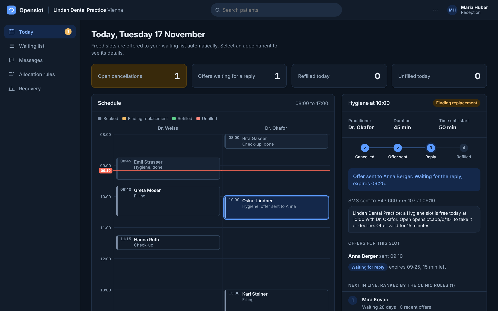
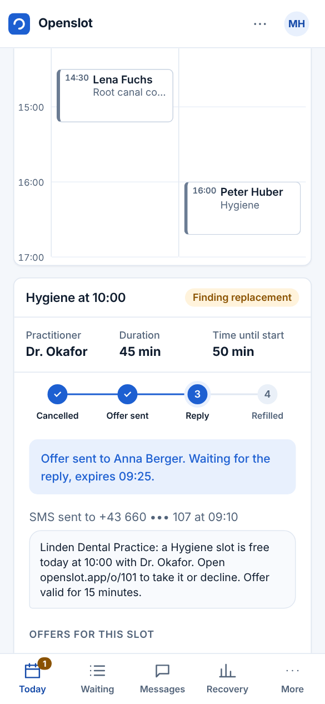
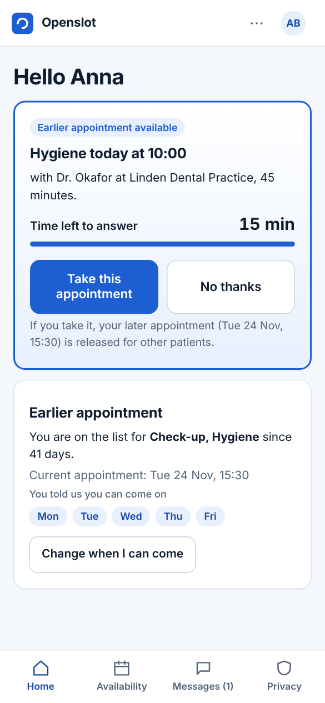
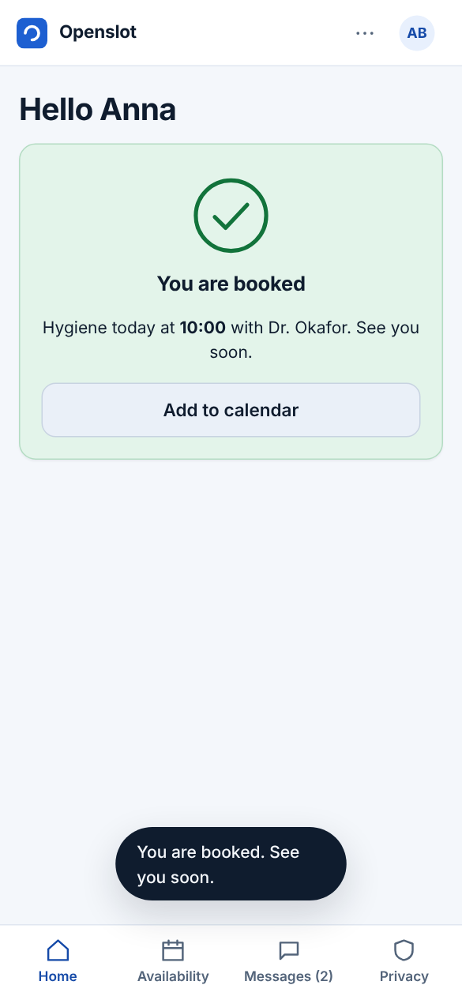

# Openslot (cancellation-demo)

A working demo of **Openslot**, a cancellation recovery product for independent clinics. When a patient cancels, Openslot finds a replacement from the waiting list, texts them an offer and fills the slot. Built for the MKI group project (Group 5, WU Vienna).

**Everything is fictional. No real patients, no real SMS, no data leaves your browser.**

## Two apps, one shared backend
- `index.html` is the **clinic app**. Sign in as Reception, Dentist or Owner.
- `patient.html` is the **patient app**. Pick a demo patient.
- Both talk to a **Supabase** database (Postgres in the cloud). A *room* is one shared demo, identified by the first part of the URL, for example `/abc123/today` (clinic app) and `/abc123/patient` (patient app). Open the patient app on your phone with the same room code (Demo tools shows a QR code) and every change appears on every device within about a second.
- If Supabase is not reachable, the demo falls back to this browser only (tabs still sync). The top bar shows **Live** or **This browser only**.

## Design and experience
- **Looks like a product, not a demo.** A clean white and blue interface (default), a quiet top bar with patient search, an account menu and a small ⋯ **demo menu** that holds everything only needed for presenting (demo clock, live status, walkthrough, demo tools, link to the other app). Demo wording is kept out of the product screens.
- **Choose your look** in the account menu: Light (default), Dark or Auto, and a Blue or Teal accent. The app stays light even on devices set to dark, unless you choose otherwise.
- **Design tokens** (colour, spacing, radius, motion) in one stylesheet.
- **Responsive on purpose:** desktop sidebar, **icon-only sidebar on tablets**, **bottom tab bar with a More sheet on phones**, touch targets of at least 44 px on touch screens, safe-area support for notched phones. Checked at 360, 390, 768, 1024, 1280 and 1920 px with no sideways scrolling.
- **Clear status at a glance:** a four-step progress bar for every cancelled slot (Cancelled, Offer sent, Reply, Refilled), colour-coded schedule with a legend, and a highlight pulse on a block when another device changes it, so the live sync is visible.
- **Patient app feels native:** countdown bar for the offer, animated success state, **Add to calendar** (.ics), sign-up with consent.
- **Honest states:** a Connecting indicator, a banner when the demo runs on this browser only, empty states, and `prefers-reduced-motion` respected.

## Presenting it
Open **Demo access** on the sign-in page to pick a role, then open the **⋯ menu** in the top bar and choose **Pitch walkthrough**. It lists six steps for the pitch and ticks each one off by itself as you do it, on any device. Steps have shortcuts ("Do it for me", "Open patient app as Anna"). **Demo tools** (also in the ⋯ menu) has a QR code for the phone, a clock you can move forward, and a button to start a fresh room.

## Try the full loop (about 2 minutes)
1. Open the clinic app, sign in as **Reception**.
2. In another window open the patient app and pick **Oskar Lindner** (appointment today 10:00). Press **Cancel appointment**.
3. Back in the clinic app, Openslot has picked the best waiting patient and sent an SMS offer. The panel shows who is next and why.
4. In a third window open the patient app as **Anna Berger**. Open the offer and press **Take this appointment**.
5. The clinic schedule turns the slot green. Check **Recovery** and the **Audit log**.
6. To see an unanswered offer, use **Demo tools, Move 15 min forward**. The offer expires and the next patient is contacted automatically.

## What is in the clinic app
- **Today**: schedule per practitioner with a live "now" line, cancellation by reception, live offer status, the SMS text, ranked next-in-line patients with the reason.
- **Waiting list**: add patients (with SMS consent), edit availability, clinical flag (dentist only), remove.
- **Messages**: every SMS Openslot sends.
- **Allocation rules**: priority order, only a dentist can change it. The approval is shown.
- **Recovery**: recovery rate, time to refill, offer acceptance rate, reply time, unfilled slots, staff time saved (demo assumption), weekly chart.
- **Settings (owner)**: automatic offers on or off, offer validity, cut-off before the slot starts, SMS template with live preview.
- **Audit log** (dentist, owner): who did what and when, CSV download.

## What is in the patient app
**Create an account and join the waiting list** (treatment, availability, notice, SMS consent), offer page (the link in the SMS), countdown, accept or decline, cancel own appointment, availability profile, SMS inbox, privacy page with consent, data download and leave-the-list.

## Run locally
No build step. Run `node server.mjs` in this folder and open http://localhost:8765 (it applies the same URL rules as `vercel.json`, so `/<room>/today` works locally). Old links with `?room=` and `#/today` still work and are redirected to the clean URL.

## Deploy on Vercel
Import the repo on vercel.com, framework preset **Other**, leave build command and output directory empty, deploy. Suggested project name `openslot-demo`.

## How the backend works
- One table, `demo_rooms (id, state jsonb, version)`, in Supabase project `openslot-demo` (Frankfurt). Row Level Security is on: the public key can read rooms, but it **cannot write directly**. Writes go through two SQL functions (`get_or_create_room`, `put_room_state`). `put_room_state` is a compare-and-swap on `version`, so two people clicking at once never overwrite each other, the app re-applies the loser's change on top.
- The browser polls the version every ~1.2 s (about 5 s when the tab is hidden). Rooms older than 14 days are purged.
- The key in `config.js` is the public (anon) key. It is meant to be public.
- The SQL is in `supabase/migration.sql`.

## Honest limits of the demo
- Anyone with a room link can change that room, and rooms are readable if you know the room code. That is fine for fictional data and a classroom demo, it is not a real security model. A real product needs authentication, per-clinic tenants, an SMS gateway, encryption and a data processing agreement with each clinic.
- Matching is deliberately simple: service, availability, notice, then the clinic rules.
- Numbers on the Recovery page for earlier weeks are sample data. "Staff time saved" assumes 12 minutes of phoning per refilled slot.
